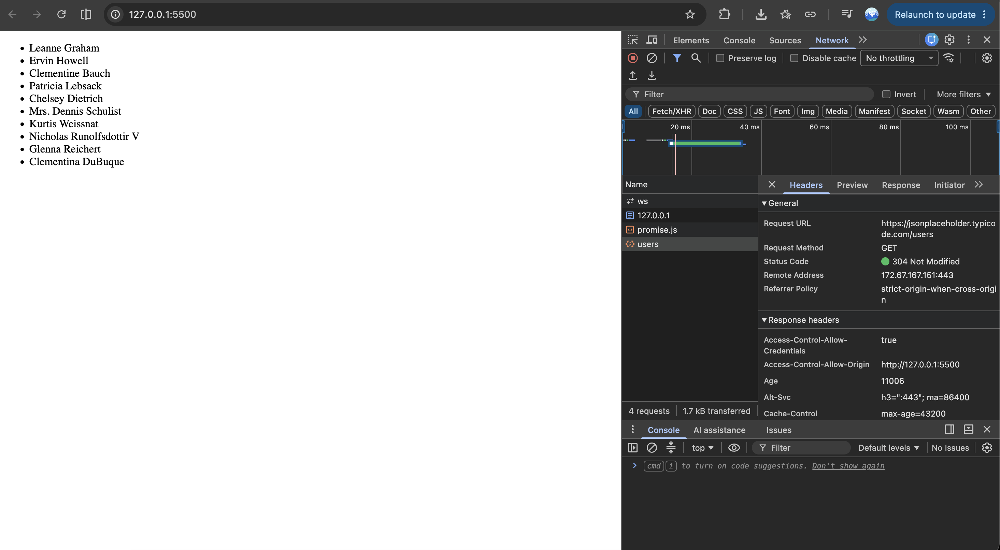

# Book Management (REST API CRUD with MockAPI)

# 22300272 ParkDongMin

## Deployment

- GitHub: https://github.com/2026-2-OSS/assign09-c01-22300272
- Vercel: https://2026ossa09.vercel.app/
- MockAPI Endpoint: https://6ae2ab38bbb54129229a3818.mockapi.io/books

## Service

- **주제**: 도서 관리
- **Field**: `id`(서버 자동 생성), `title`, `author`, `category`, `price`, `year`
- **CRUD 기능**
  - GET: 페이지 로드 시 MockAPI에서 목록을 조회해 화면에 출력
  - POST: 폼 입력값을 서버에 추가하고 목록 갱신
  - PUT: [수정] 버튼으로 기존 값을 폼에 불러와 수정한 뒤 서버에 반영
  - DELETE: `confirm()` 확인 후 서버 데이터 삭제
- **검색**: 제목 기준 검색 (`filter()`)
- **Validation** (추가/수정 공통): 제목 필수, 저자 필수 및 2자 이상, 분류 필수, 가격 1 이상 숫자, 연도 1900~2026 숫자
- **오류/상태 처리**: 요청 실패 시 화면에 오류 메시지 표시, 성공 시 목록 갱신, 새로고침 후에도 서버 데이터 유지

## Key Learning

1. **fetch() + async/await + response.ok**
   `fetch()`는 Promise를 반환하고 `await`로 결과를 기다리는게 핵심이엇다.
    404, 500 같은 HTTP 오류는 fetch가 자동으로 reject하지 않으므로 `response.ok`를 직접 확인하고 `throw`해야 하며, 이를 `try/catch`로 받아 화면에 오류 메시지를 표시한다.
2. **JSON과 REST API**
   서버와는 JSON 문자열로 데이터를 주고받는다. 응답은 `response.json()`으로 JS 배열로 변환하고, 전송할 때는 `JSON.stringify()`와 `Content-Type: application/json` 헤더가 필요하다. 같은 주소(`/books`)도 GET/POST/PUT/DELETE 메서드에 따라 동작이 구분되고, 수정·삭제는 주소 끝에 id(`/books/3`)를 붙인다. 과제 중간에도 

## AI / Search Usage
DELETE 요청 함수의 기본 구조 개념 참고(method: "DELETE", 주소 끝에 id 추가)
PUT 요청 함수 구조와 PATCH 대신 PUT을 쓰는 방향
검색 filter() 구조

DELETE 요청 방법을 몰라 AI에게 구조를 물어 참고함. 이후 삭제가 404로 실패한 원인을 Console의 주소(books/$%7Bid%7D)로 확인했고, 작은따옴표를 백틱으로 바꿔 해결함. PUT은 200인데 값이 반영되지 않는 문제의 원인이 Content-Type 헤더 누락임을 확인해 headers를 추가함. 삭제 후 목록 갱신과 수정 중 삭제 시 입력칸 초기화는 직접 작성함. 이 외에 UI, validation(), editId 분기, 배포를 직접 진행함

DELETE는 body와 headers 없이 method와 주소의 id만으로 동작함. 템플릿 리터럴은 백틱에서만 ${}가 치환됨. JSON을 보내는 요청에는 Content-Type 헤더가 필요함
## Problem & Solution

1. **PATCH 요청이 CORS로 차단됨**
   - 문제: `Method PATCH is not allowed by Access-Control-Allow-Methods in preflight response`
   - 원인: MockAPI가 허용하는 메서드는 GET, PUT, POST, DELETE, OPTIONS
   - 해결: PATCH 대신 PUT 사용
2. **PUT 요청이 200인데 값이 반영되지 않음**
   - 원인: `Content-Type: application/json` 헤더 누락으로 서버가 body를 JSON으로 읽지 못함
   - 해결: `headers`에 `Content-Type` 추가
3. **삭제 요청이 404**
   - 원인: 작은따옴표로 쓴 주소에서 `${id}`가 치환되지 않고 글자 그대로 전송됨 (`books/$%7Bid%7D`)
   - 해결: 백틱(`` ` ``)으로 변경

## Reflection
API 가 뭔지부터 감이 잘 안왔는데 직접 코드를 API 버전으로 수정해보니까 전보다 감이 잡힌 것 같다.

## SAMPLE study
